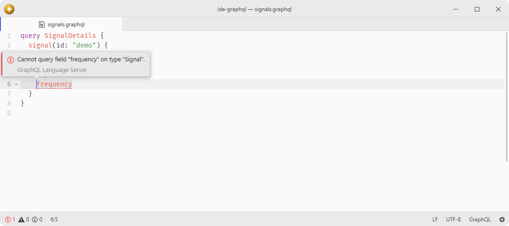

# ide-graphql

GraphQL language-server adapter.

Registers the bundled GraphQL Language Service with `ide`, providing schema-aware diagnostics, completion, hover, navigation, and symbols for GraphQL documents, plus language features for GraphQL template literals in JavaScript, TypeScript, and Vue files.

## Features

- **Bundled server**: pins GraphQL 17 and the compatible GraphQL Language Service CLI 4 release candidate exactly, with an optional custom executable path.
- **Managed upgrade**: installs a newer server from npm when you want one, and removing it returns to the bundled copy.
- **Schema intelligence**: validates operations and schema definitions and completes fields, arguments, types, directives, and variables.
- **Navigation and documentation**: follows schema fields, types, and fragments and shows their documentation on hover.
- **Project structure**: supplies document and workspace symbols from GraphQL config projects.
- **Embedded documents**: understands supported GraphQL template tags inside JavaScript, TypeScript, JSX, TSX, and Vue files.
- **Configuration**: controls GraphQL config discovery, legacy config support, dotenv loading, schema caching, and debug logging.
- **Feature switches**: each shared IDE capability can be handed to another server serving the same file.
- **Project sessions**: keeps one server and GraphQL config cache per project root instead of merging unrelated schemas.

Whole-document symbols belong to GraphQL buffers. GraphQL template literals retain completion, hover and navigation inside their JavaScript, TypeScript or Vue host, whose document symbols come from the host language. Workspace symbol search remains available for GraphQL config projects.

## Installation

To install `ide-graphql` search for it in the Install pane of the Lumine settings, or run the command `lumine --install lumine-code/ide-graphql`.

Install `ide` first.

## Usage

Bundled and managed npm installations use GraphQL 17 with the official CLI 4 server and the same dependency policy. Managed discovery selects the upstream `rc` channel until a compatible stable CLI is available. Remove an older managed CLI 3 installation and install it again before using this adapter. See [dependency security](docs/security.md) for the tested fixes and audit policy.

## Services

- `ide`: consumed to register the GraphQL adapter with the editor's language-server client.

## Contributing

Got ideas to make this package better, found a bug, or want to help add new features? Just drop your thoughts on GitHub. Any feedback is welcome!
